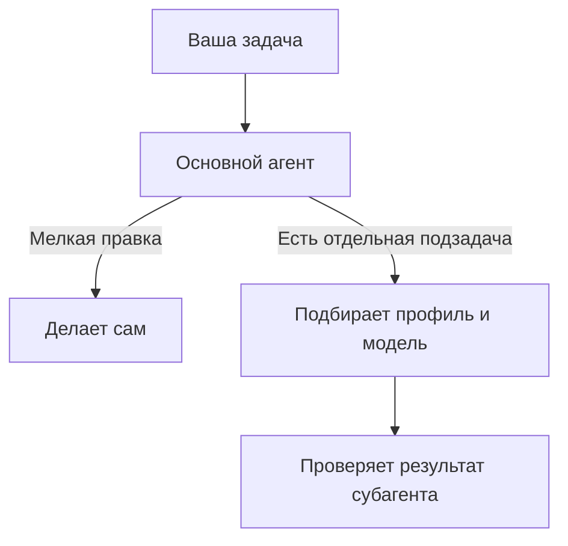

# Agent Routing Kit

**Дайте задачу Claude Code или Codex. Агент сам решит, какие шаги делегировать и какую модель для них подключить.**

Допустим, вы просите поправить фильтр в каталоге. Быстрый субагент может найти нужные файлы и передать короткую сводку. Основной агент решает, как внести правку и проверить, что фильтр работает.

**[Установить в проект](#быстрый-старт)** · [Скачать ZIP](./agent-routing-kit.zip?raw=true) · [Открыть инструкцию для агента](INSTALL.md)

## Быстрый старт

Откройте папку своего проекта в **Claude Code** или **Codex** и отправьте в чат:

```text
Установи Agent Routing Kit в текущий проект по инструкции:
https://github.com/knizhnikoff/agent-routing-kit/blob/main/INSTALL.md
```

Агент скачает архив и покажет план установки. Установщик проверяет конфликты перед записью, а при дополнении существующего `AGENTS.md` сохраняет резервную копию. После установки откройте новую сессию в той же папке.

Для установки нужен Python 3.8+. Если чат не может скачать архив, [скачайте ZIP](./agent-routing-kit.zip?raw=true) и приложите его. Инструкции для терминала есть внутри архива.

## Как агент выбирает исполнителя



| Инструмент | Что добавляет комплект |
| --- | --- |
| **Claude Code** | Два профиля Haiku для небольших правок и отдельного ревью. Сложные решения остаются в основной сессии. |
| **Codex** | Семь профилей, в том числе для поиска по коду, разработки, анализа, архитектуры и ревью. |

Комплект добавляет правила и профили в выбранный проект. Модель основного чата выбирается отдельно, а доступные модели зависят от вашего аккаунта.

## Попробуйте после установки

```text
Найди, где в проекте формируется меню сайта, и коротко объясни, как оно устроено. Файлы пока не меняй.
```

В **Codex** для отдельного поиска есть профиль `kit_fast_explorer`. В **Claude Code** попробуйте небольшую правку с чёткими границами, например изменение подписи одного пункта меню. Для таких правок есть `worker-haiku`.

Быстрая модель и короткая сводка помогают сократить работу основной модели. Для оценки расхода сравнивайте всю задачу, включая вызовы субагентов и ревью.

Если комплект пригодился, поставьте звезду, чтобы сохранить его в GitHub.

Артём Книжников · [Telegram](https://t.me/knizhnikoff)
